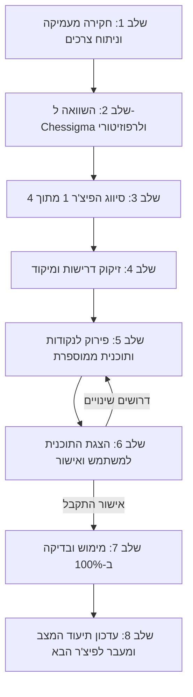

# פרוטוקול פיתוח לפיצ'רים (Framework Guidelines)

מסמך הנחיות מחייב לכל שלב בפיתוח פרויקט השחמט מול אתר הייחוס **Chessigma** והרפוזיטורי **veyra-chess**.

---

## 📌 עקרונות ברזל
1. **פיצ'ר אחד בכל פעם**: אין להתחיל פיצ'ר חדש לפני שהפיצ'ר הנוכחי הושלם ב-100% ואושר.
2. **אפס עבודה ללא הבנה מלאה**: אין לכתוב קוד או לתכנן לפני חקירה מעמיקה של הבעיה והפתרון.
3. **אישור מפורש מהמשתמש**: לעולם לא מתחילים במימוש לפני הצגת תוכנית מפורטת וקבלת אישור המשתמש.
4. **תיעוד מתמיד ושימור מצב**: עדכון קובץ מצב (Status Tracker) בכל שלב כדי לאפשר המשכיות חלקה בין סשנים.

---

## 🔄 שלבי העבודה עבור כל פיצ'ר

---

### שלב 1: חקירה מעמיקה של הפיצ'ר
לפני כל תכנון, יש להשקיע את כל הזמן והמאמץ הנדרש כדי לענות על השאלות הבאות:
- **מה הפיצ'ר עושה?** תיאור פונקציונלי מלא.
- **איזו בעיה הוא פותר?** ולמה הבעיה הזו קריטית למשתמש/לשחקן?
- **מיהו קהל היעד?** מי המשתמשים שישתמשו בו ומה הציפייה שלהם?
- **מה הופך אותו למצוין?** חוויית משתמש (UX), ביצועים, דיוק, עיצוב.
- **התנהגות במצבי קצה (Edge Cases):** שגיאות רשת, ניתוקים, מצבים לא חוקיים בלוח, רזולוציות שונות וכו'.
- **מהי ארכיטקטורת המימוש האופטימלית?**

---

### שלב 2 + 3: השוואה מול Chessigma והרפוזיטורי הקיים (veyra-chess)
ניתוח מעמיק של ההתנהגות ב-Chessigma אל מול הקוד הקיים ב-`veyra-chess`, וסיווג לאחת מ-4 הקטגוריות:

| # | סיווג | תנאי סיווג | פעולה נדרשת |
|---|---|---|---|
| **1** | **צריך לבנות מאפס** | הרפוזיטורי אינו מכיל את הפיצ'ר כלל | תכנון ובנייה מלאה מ-0 |
| **2** | **צריך לבנות מחדש** | קיים מימוש, אך הוא אינו דומה/מתאים, אינו מתפקד כראוי, או יוצר חוב טכני | מחיקה/החלפה של הקיים ובנייה מחדש |
| **3** | **צריך לשנות מעט** | קיים בסיס טוב ועובד שקרוב לדרישה | התאמות ממוקדות וליטושים |
| **4** | **הכול כבר קיים ואין צורך לשנות** | המימוש הקיים עונה במלואו על הדרישות ואומת בבדיקות | בדיקה, תיעוד, וסימון כהושלם |

---

### שלב 4: זיקוק הדרישות ונטרול רעשים
- בירור מדויק של מה **חובה שיהיה** בפיצ'ר לפי חזון המשתמש.
- הגדרה ברורה של מה **מיותר או לא נחוץ**, כדי למנוע השקעת זמן מיותרת בפיצ'רי-סרק.

---

### שלב 5: פירוק לנקודות ותוכנית עבודה מפורטת
1. חלוקת הפיצ'ר לנקודות קטנות ועצמאיות.
2. הבנת כל נקודה לעומק.
3. מיספור הנקודות לפי **סדר העבודה הנכון וההגיוני ביותר**.
4. פירוט מפורש:
   - מה קיים כעת.
   - מה בדיוק נבנה או ישונה.
   - מהם קבצי היעד.
   - כיצד תיבדק התקינות.

---

### שלב 6: הצגה לאישור המשתמש (Gatekeeper)
- הצגת התוכנית השלמה בצורה קריאה ונגישה להורדה / כקובץ בפרויקט.
- **עצירה מלאה** והמתנה לאישור המשתמש. אין לגעת בקוד לפני אישור!

---

### שלב 7: מימוש מלא (100%) ובדיקות
- ביצוע מדויק של שלבי התוכנית המאושרת.
- בדיקות תקינות לווידוא שהפיצ'ר עובד מקצה לקצה.

---

### שלב 8: עדכון מצב הפרויקט (Project Status Tracking)
- עדכון קובץ `PROJECT_STATUS.md` במידע על השלמת הפיצ'ר.
- תיעוד מה בוצע, מה המצב הקיים, ומהו הפיצ'ר הבא בתור.
- שמירה מלאה שתאפשר המשך עבודה מדויק בכל שיחה עתידית.

